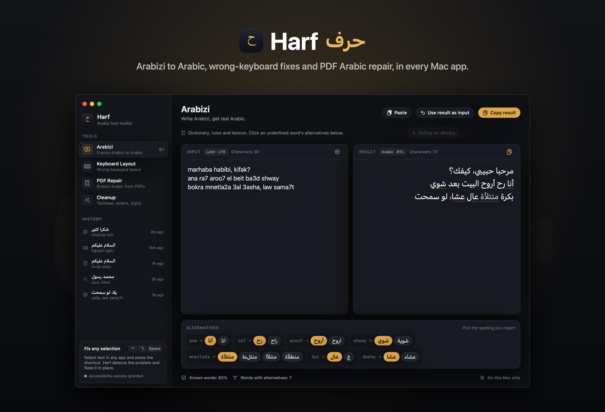
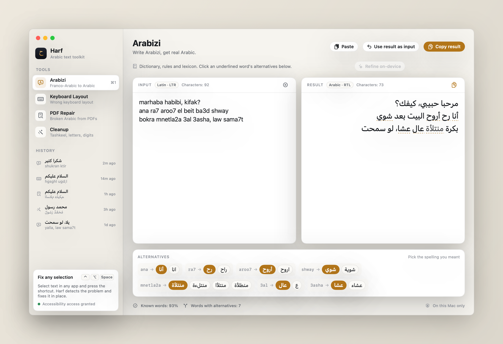
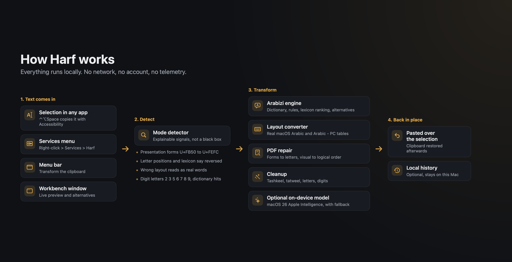

<div align="center">

[العربية](README.md) | **English**

# Harf

**A native macOS app that fixes Arabic text in any app: Arabizi to Arabic, text typed on the wrong keyboard layout, broken Arabic copied from PDFs, and tashkeel and digit cleanup.**

[](https://github.com/mohammadhadijavidi/harf/actions/workflows/ci.yml)
[](LICENSE)




<sub>Screenshot rendered from the real app views with built-in sample text.</sub>

</div>

Harf (حرف, "letter") is a Mac menu bar app and workbench for Arabic text. Select text anywhere, press <kbd>⌃</kbd><kbd>⌥</kbd><kbd>Space</kbd>, and Harf detects what is wrong and fixes it in place. It runs entirely on your Mac, with no network access.

## Why

Arabic on a Mac breaks in a few recurring ways, and the usual fixes are scattered:

- **Arabizi / Franco-Arabic** ("ana ra7 aroo7 el beit") is how many people type on phones and in chats. Web converters such as Yamli or Google Input Tools need a browser and send your text to a server. Harf converts on device, in any app, and shows alternatives for ambiguous words.
- **Wrong keyboard layout** ("hgsghl ugd;l" instead of "السلام عليكم"). Layout switchers exist for other scripts and platforms; on the Mac you usually retype. Harf uses tables dumped from the real macOS Arabic and Arabic - PC layouts and detects the direction and layout for you.
- **Broken PDF Arabic**. Copying from many PDFs gives presentation-form glyphs, reversed letter order and split lam-alef. Online "fix Arabic PDF text" pages exist, but again need a browser and an upload. Harf repairs it locally.
- **Cleanup**: removing tashkeel, normalizing letters for search, and converting between Western, Arabic-Indic and Persian digits.

## Features

| | |
|---|---|
| **Arabizi to Arabic** | Digit letters (2, 3, 3', 5, 6, 6', 7, 7', 8, 9, 9'), digraphs (sh, kh, gh, th, dh), vowel rules, al-/el- and sun-letter forms (ash-shams), attached particles and pronoun suffixes, multi-word phrases, and a curated dictionary of everyday Gulf, Levantine and Egyptian words. Ambiguous words are underlined and offer alternatives. |
| **On-device refinement (optional)** | On macOS 26 with Apple Intelligence enabled, Harf can ask Apple's on-device model to polish the spelling. Answers are validated (mostly Arabic, similar length, no added lines) and the deterministic result is kept otherwise. Clearly labelled in the UI. |
| **Keyboard layout fix** | Both directions, Latin to Arabic and Arabic to Latin, using the real macOS `Arabic` and `ArabicPC` layouts. Direction and layout are detected automatically by scoring results against an Arabic lexicon and an English word list. |
| **PDF repair** | Presentation Forms (U+FB50 to U+FEFC) back to base letters, lam-alef ligatures split, reversed visual-order lines detected and put back into logical order (numbers and Latin kept intact, brackets mirrored), tatweel and invisible marks removed. |
| **Cleanup** | Remove tashkeel and tatweel, optional normalization (alef forms, alef maqsura, ta marbuta, hamza seats, Persian letters), digits to Western, Arabic-Indic or Persian. |
| **Smart fix** | A detector picks the right tool and explains why ("This looks like Arabic typed on an English keyboard."). Plain English is left alone. |
| **Works everywhere** | Global shortcuts (Carbon `RegisterEventHotKey`), the macOS Services menu, a menu bar extra that transforms the clipboard, and a workbench window with live preview, history and drag and drop. |
| **Bilingual** | Full Arabic (right to left) and English interface from String Catalogs, switchable in Settings. Light and dark mode. |

### Global shortcuts

| Shortcut | Action |
|---|---|
| <kbd>⌃</kbd><kbd>⌥</kbd><kbd>Space</kbd> | Smart fix the selection |
| <kbd>⌃</kbd><kbd>⌥</kbd><kbd>A</kbd> | Arabizi to Arabic |
| <kbd>⌃</kbd><kbd>⌥</kbd><kbd>K</kbd> | Keyboard layout fix |
| <kbd>⌃</kbd><kbd>⌥</kbd><kbd>P</kbd> | PDF repair |
| <kbd>⌃</kbd><kbd>⌥</kbd><kbd>T</kbd> | Cleanup |

In the workbench: <kbd>⌘</kbd><kbd>1</kbd> to <kbd>⌘</kbd><kbd>4</kbd> switch tools, <kbd>⌘</kbd><kbd>⇧</kbd><kbd>C</kbd> copies the result, <kbd>⌘</kbd><kbd>⇧</kbd><kbd>V</kbd> pastes as input.



<sub>Light mode, rendered from the real app views with sample text.</sub>

## Download

1. Download `Harf.zip` from [GitHub Releases](https://github.com/mohammadhadijavidi/harf/releases) and move `Harf.app` to Applications.
2. Harf is ad-hoc signed and **not notarized**, so macOS blocks the first launch. Right-click the app and choose **Open**, or run:

   ```sh
   xattr -dr com.apple.quarantine /Applications/Harf.app
   ```

3. For the global shortcuts, allow Harf in **System Settings > Privacy & Security > Accessibility**. Services and the workbench work without it.

Requires macOS 14 Sonoma or later. On-device refinement requires macOS 26 with Apple Intelligence.

## Build from source

```sh
brew install xcodegen
git clone https://github.com/mohammadhadijavidi/harf.git
cd harf
xcodegen generate
xcodebuild -scheme Harf -destination 'platform=macOS' test   # run the unit tests
./scripts/build-release.sh                                  # dist/Harf.zip
```

Xcode 26 is recommended (Swift 6.2 for the FoundationModels integration). The project has no third-party dependencies.

## How it works



- **HarfCore** (framework) holds all text logic and is fully unit tested. The app target only adds UI and system integration.
- **Arabizi**: the longest dictionary phrase wins; then the article, particles and suffixes around dictionary words; then a rule engine generates candidate spellings (each letter or vowel has a default reading and alternatives with a cost) and ranks them with an Arabic lexicon. Words found only by the rules are shown slightly dimmed.
- **Keyboard layouts**: `scripts/dump-layouts.swift` asks `UCKeyTranslate` what every key types on macOS; `scripts/gen-layout-tables.py` turns that dump into Swift tables.
- **PDF repair**: reversal is decided from evidence: presentation-form shapes (a final form at the start of a word is impossible in logical order), letters that never start a word (ة, ى), and whether words or their mirror images exist in the lexicon.
- **Selection in place**: Harf saves your clipboard, sends Cmd-C, transforms the text, sends Cmd-V and restores the clipboard. Temporary items are marked transient for clipboard managers.

## Privacy

- No network access, no analytics, no accounts. Harf makes no network requests.
- Text is processed in memory. With the global shortcut, Harf reads the selection through a simulated copy and restores your previous clipboard.
- History (last 60 conversions) is stored only in the app's preferences on your Mac and can be turned off or cleared.
- The optional refinement uses Apple's on-device model through FoundationModels; nothing is sent off the Mac by Harf.

## Limitations

- Arabizi has no single standard. The dictionary covers common everyday words; other words fall back to rules and may need an alternative picked. Long vowels and emphatic letters are the usual sources of mistakes.
- The keyboard fix covers the macOS `Arabic` and `Arabic - PC` layouts (not QWERTY or AZERTY Arabic variants yet).
- Reversal detection is heuristic. For a single short word with no evidence, use **Always reverse**.
- In-place replacement depends on the frontmost app supporting Cmd-C and Cmd-V. Secure text fields are not supported.
- The FoundationModels refinement could not be exercised on CI runners (no Apple Intelligence there); it is guarded and validated, and falls back to the rule-based result.

## Roadmap

- Customizable shortcuts.
- More layouts (Arabic QWERTY, AZERTY, Persian, Urdu).
- User dictionary for Arabizi with import and export.
- A Share extension and a Shortcuts action.

## Contributing

See [CONTRIBUTING.md](CONTRIBUTING.md). Wrong conversions are the most useful bug reports: include the input, the output and what you expected.

## License

[MIT](LICENSE), Copyright (c) 2026 Mohammad Hadi Javidi.

---

Built by [Mohammad Hadi Javidi](https://mohammadhadijavidi.github.io) (محمد هادی جاویدی) — AI products & automation, Dubai. More work on [GitHub](https://github.com/mohammadhadijavidi).
