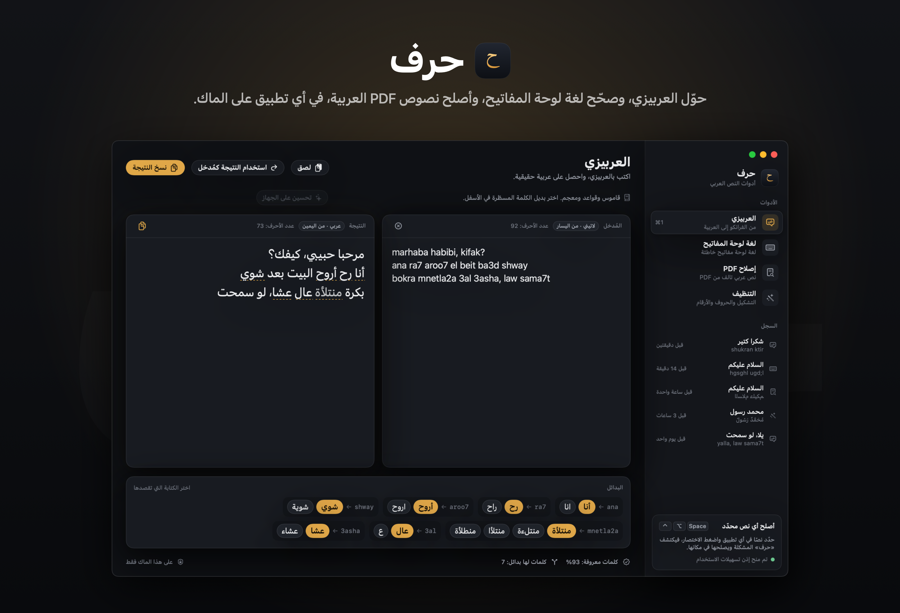
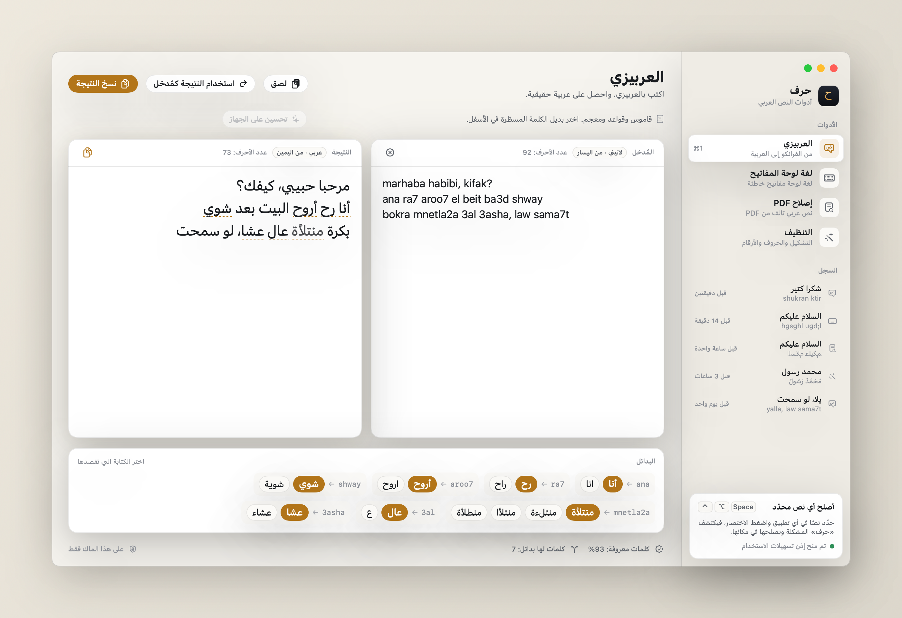
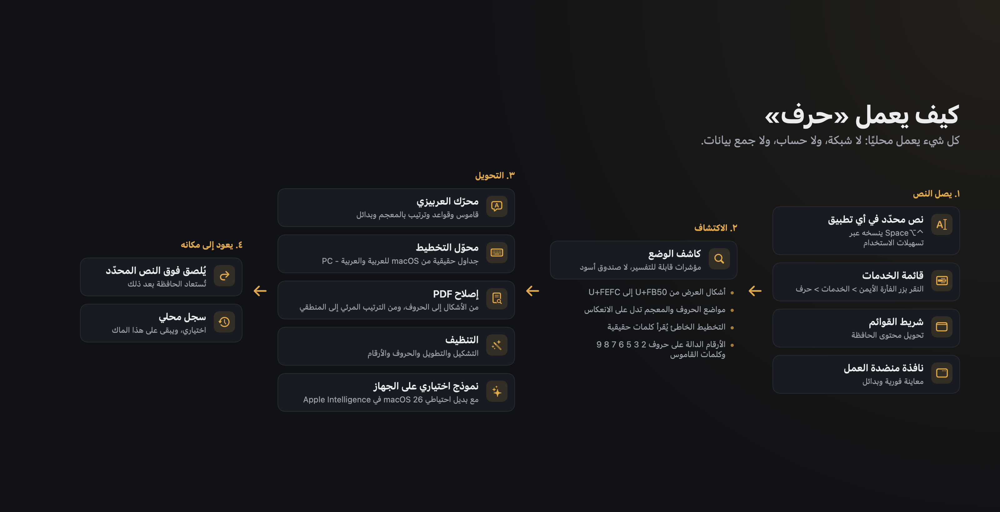

<div dir="rtl">

<div align="center">

**العربية** | [English](README.en.md)

# حرف

**تطبيق أصلي لنظام macOS يصلح النص العربي في أي تطبيق: تحويل العربيزي إلى العربية، وتصحيح النص المكتوب بلغة لوحة مفاتيح خاطئة، وإصلاح النص العربي المنسوخ من ملفات PDF، وتنظيف التشكيل وتحويل الأرقام.**

[](https://github.com/mohammadhadijavidi/harf/actions/workflows/ci.yml)
[](LICENSE)




<sub>لقطة مُولّدة من واجهات التطبيق الحقيقية باستخدام نص تجريبي مدمج.</sub>

</div>

«حرف» تطبيق لشريط القوائم ومنضدة عمل للنص العربي على الماك. حدّد نصًا في أي مكان، واضغط <kbd>⌃</kbd><kbd>⌥</kbd><kbd>Space</kbd>، فيكتشف التطبيق المشكلة ويصلحها في مكانها. يعمل التطبيق بالكامل على جهازك دون أي اتصال بالشبكة.

## لماذا «حرف»؟

يتعطّل النص العربي على الماك بطرق متكررة، والحلول المتاحة متفرقة:

- **العربيزي (الفرانكو آراب)** مثل «ana ra7 aroo7 el beit» هو أسلوب كتابة شائع في الهواتف والمحادثات. تحتاج المحوّلات المتاحة على الويب، مثل Yamli وأدوات الإدخال من Google، إلى متصفح وترسل نصك إلى خادم. أما «حرف» فيحوّل النص على الجهاز، في أي تطبيق، ويعرض بدائل للكلمات المحتملة لأكثر من كتابة.
- **لغة لوحة المفاتيح الخاطئة**، مثل «hgsghl ugd;l» بدلًا من «السلام عليكم». على الماك يضطر المستخدم عادةً إلى إعادة الكتابة. يعتمد «حرف» على جداول مستخرجة من تخطيطَي macOS الحقيقيين «العربية» و«العربية - PC»، ويكتشف الاتجاه والتخطيط تلقائيًا.
- **نص PDF العربي التالف**: كثير من ملفات PDF تعطي عند النسخ أشكال عرض (Presentation Forms) وحروفًا بترتيب معكوس وأربطة لام ألف. توجد صفحات ويب لإصلاح ذلك، لكنها تتطلب رفع النص. أما «حرف» فيصلحه محليًا.
- **التنظيف**: إزالة التشكيل، وتوحيد الحروف لأغراض البحث، والتحويل بين الأرقام الغربية والعربية الهندية والفارسية.

## المزايا

| | |
|---|---|
| **من العربيزي إلى العربية** | الأرقام الدالة على حروف (2، 3، '3، 5، 6، '6، 7، '7، 8، 9، '9)، والحروف المركّبة (sh وkh وgh وth وdh)، وقواعد الحركات، وأداة التعريف al-/el- مع الحروف الشمسية (ash-shams)، والسوابق واللواحق الضميرية، والعبارات متعددة الكلمات، وقاموس منتقى لكلمات يومية خليجية وشامية ومصرية. تُسطَّر الكلمات الملتبسة ويُعرض لها بدائل. |
| **تحسين اختياري على الجهاز** | على macOS 26 مع تفعيل Apple Intelligence، يمكن لـ«حرف» أن يطلب من نموذج Apple المحلي تحسين الإملاء. تُتحقق الإجابة (أغلبها عربي، وطولها مقارب، ولا أسطر مضافة)، وإلا تُعتمد النتيجة الحتمية. الميزة موسومة بوضوح في الواجهة. |
| **تصحيح لغة لوحة المفاتيح** | في الاتجاهين، من اللاتينية إلى العربية والعكس، باستخدام تخطيطَي macOS الحقيقيين `Arabic` و`ArabicPC`. يُكتشف الاتجاه والتخطيط تلقائيًا بمقارنة النتائج بمعجم عربي وقائمة كلمات إنجليزية. |
| **إصلاح PDF** | تحويل أشكال العرض (من U+FB50 إلى U+FEFC) إلى الحروف الأساسية، وفك أربطة لام ألف، واكتشاف الأسطر ذات الترتيب المرئي المعكوس وإعادتها إلى الترتيب المنطقي (مع الحفاظ على الأرقام والنصوص اللاتينية وعكس الأقواس)، وإزالة التطويل والعلامات الخفية. |
| **التنظيف** | إزالة التشكيل والتطويل، وتوحيد اختياري (أشكال الألف، والألف المقصورة، والتاء المربوطة، وكراسي الهمزة، والحروف الفارسية)، وتحويل الأرقام إلى الغربية أو العربية الهندية أو الفارسية. |
| **الإصلاح الذكي** | يختار كاشف الوضع الأداة المناسبة ويشرح السبب، مثل: «يبدو هذا نصًا عربيًا كُتب على لوحة مفاتيح إنجليزية». ويُترك النص الإنجليزي العادي دون تغيير. |
| **يعمل في كل مكان** | اختصارات عامة (عبر `RegisterEventHotKey` من Carbon)، وقائمة الخدمات في macOS، وعنصر في شريط القوائم يحوّل محتوى الحافظة، ونافذة منضدة عمل فيها معاينة فورية وسجل ودعم السحب والإفلات. |
| **ثنائي اللغة** | واجهة عربية كاملة من اليمين إلى اليسار وأخرى إنجليزية عبر String Catalogs، مع إمكانية التبديل من الإعدادات، ودعم الوضعين الفاتح والداكن. |

### الاختصارات العامة

| الاختصار | الإجراء |
|---|---|
| <kbd>⌃</kbd><kbd>⌥</kbd><kbd>Space</kbd> | إصلاح ذكي للنص المحدّد |
| <kbd>⌃</kbd><kbd>⌥</kbd><kbd>A</kbd> | من العربيزي إلى العربية |
| <kbd>⌃</kbd><kbd>⌥</kbd><kbd>K</kbd> | تصحيح لغة لوحة المفاتيح |
| <kbd>⌃</kbd><kbd>⌥</kbd><kbd>P</kbd> | إصلاح PDF |
| <kbd>⌃</kbd><kbd>⌥</kbd><kbd>T</kbd> | التنظيف |

في منضدة العمل: <kbd>⌘</kbd><kbd>1</kbd> إلى <kbd>⌘</kbd><kbd>4</kbd> للتنقل بين الأدوات، و<kbd>⌘</kbd><kbd>⇧</kbd><kbd>C</kbd> لنسخ النتيجة، و<kbd>⌘</kbd><kbd>⇧</kbd><kbd>V</kbd> للّصق كمُدخل.



<sub>الوضع الفاتح، مُولّد من واجهات التطبيق الحقيقية باستخدام نص تجريبي.</sub>

## التنزيل

1. نزّل الملف `Harf.zip` من [إصدارات GitHub](https://github.com/mohammadhadijavidi/harf/releases)، ثم انقل `Harf.app` إلى مجلد التطبيقات.
2. التطبيق موقّع توقيعًا محليًا (ad-hoc) و**غير موثّق لدى Apple (not notarized)**، لذا يمنع macOS تشغيله في المرة الأولى. انقر عليه بزر الفأرة الأيمن واختر **فتح**، أو نفّذ الأمر:

   <div dir="ltr">

   ```sh
   xattr -dr com.apple.quarantine /Applications/Harf.app
   ```

   </div>

3. لتفعيل الاختصارات العامة، اسمح لـ«حرف» من **إعدادات النظام > الخصوصية والأمن > تسهيلات الاستخدام**. أما قائمة الخدمات ومنضدة العمل فتعملان دون هذا الإذن.

يتطلب التطبيق macOS 14 (Sonoma) أو أحدث، ويتطلب التحسين على الجهاز macOS 26 مع Apple Intelligence.

## البناء من المصدر

<div dir="ltr">

```sh
brew install xcodegen
git clone https://github.com/mohammadhadijavidi/harf.git
cd harf
xcodegen generate
xcodebuild -scheme Harf -destination 'platform=macOS' test   # run the unit tests
./scripts/build-release.sh                                  # dist/Harf.zip
```

</div>

يُنصح باستخدام Xcode 26 (لغة Swift 6.2 لدعم FoundationModels). لا يعتمد المشروع على أي مكتبات خارجية.

## كيف يعمل



- **HarfCore** إطار عمل يضم منطق معالجة النص كله، ومغطّى باختبارات وحدات. أما هدف التطبيق فيضيف الواجهة والتكامل مع النظام فقط.
- **العربيزي**: تُقدَّم أطول عبارة موجودة في القاموس، ثم أداة التعريف والسوابق واللواحق حول كلمات القاموس، ثم يولّد محرّك القواعد كتابات مرشّحة (لكل حرف أو حركة قراءة افتراضية وبدائل بتكلفة)، ويرتّبها وفق معجم عربي. تظهر الكلمات المستنتجة بالقواعد وحدها بلون أخفت قليلًا.
- **تخطيطات لوحة المفاتيح**: يسأل السكربت `scripts/dump-layouts.swift` الدالة `UCKeyTranslate` عمّا يكتبه كل مفتاح في macOS، ثم يحوّل `scripts/gen-layout-tables.py` الناتج إلى جداول Swift.
- **إصلاح PDF**: يُقرَّر الانعكاس بناءً على قرائن: أشكال الحروف (لا يمكن أن يبدأ الشكل النهائي كلمةً في الترتيب المنطقي)، والحروف التي لا تأتي في أول الكلمة (ة، ى)، ووجود الكلمة أو صورتها المعكوسة في المعجم.
- **الاستبدال في المكان**: يحفظ «حرف» محتوى الحافظة، ثم يرسل Cmd-C، ويحوّل النص، ثم يرسل Cmd-V ويستعيد الحافظة. وتُوسَم العناصر المؤقتة بأنها عابرة كي تتجاهلها برامج إدارة الحافظة.

## الخصوصية

- لا وصول إلى الشبكة، ولا تحليلات، ولا حسابات. لا يرسل «حرف» أي طلب عبر الشبكة.
- يُعالج النص في الذاكرة. وعند استخدام الاختصار العام يقرأ «حرف» النص المحدّد عبر نسخ مُحاكى، ثم يستعيد محتوى حافظتك السابق.
- يُحفظ السجل (آخر 60 تحويلًا) في تفضيلات التطبيق على جهازك فقط، ويمكن إيقافه أو مسحه.
- يستخدم التحسين الاختياري نموذج Apple المحلي عبر FoundationModels، ولا يرسل «حرف» أي شيء خارج الجهاز.

## القيود المعروفة

- لا يوجد معيار موحّد للعربيزي. يغطي القاموس الكلمات اليومية الشائعة، أما غيرها فيعتمد على القواعد وقد يحتاج إلى اختيار بديل. والحركات الطويلة والحروف المفخّمة أكثر مصادر الأخطاء.
- يدعم تصحيح لوحة المفاتيح تخطيطَي macOS «العربية» و«العربية - PC» فقط حاليًا، دون تخطيطات QWERTY وAZERTY العربية.
- اكتشاف الانعكاس استدلالي؛ ففي حالة كلمة قصيرة واحدة بلا قرائن، استخدم خيار **اعكس دائمًا**.
- يعتمد الاستبدال في المكان على دعم التطبيق الأمامي للأمرين Cmd-C وCmd-V، ولا تُدعم حقول النص الآمنة.
- لم يكن ممكنًا اختبار التحسين عبر FoundationModels على خوادم CI لعدم توفر Apple Intelligence فيها؛ لذا فهو محمي ويُتحقق من ناتجه، ويعود إلى نتيجة القواعد عند الحاجة.

## خارطة الطريق

- اختصارات قابلة للتخصيص.
- تخطيطات إضافية (العربية QWERTY وAZERTY والفارسية والأردية).
- قاموس مستخدم للعربيزي مع الاستيراد والتصدير.
- امتداد مشاركة وإجراء في تطبيق «الاختصارات».

## المساهمة

راجع [CONTRIBUTING.md](CONTRIBUTING.md). أكثر البلاغات فائدةً هي التحويلات الخاطئة: أرفق النص المُدخل، والناتج، وما كنت تتوقعه.

## الترخيص

[MIT](LICENSE)، حقوق النشر (c) 2026 محمد هادي جاويدي (Mohammad Hadi Javidi).

---

Built by [Mohammad Hadi Javidi](https://mohammadhadijavidi.github.io) (محمد هادی جاویدی) — AI products & automation, Dubai. More work on [GitHub](https://github.com/mohammadhadijavidi).

</div>
